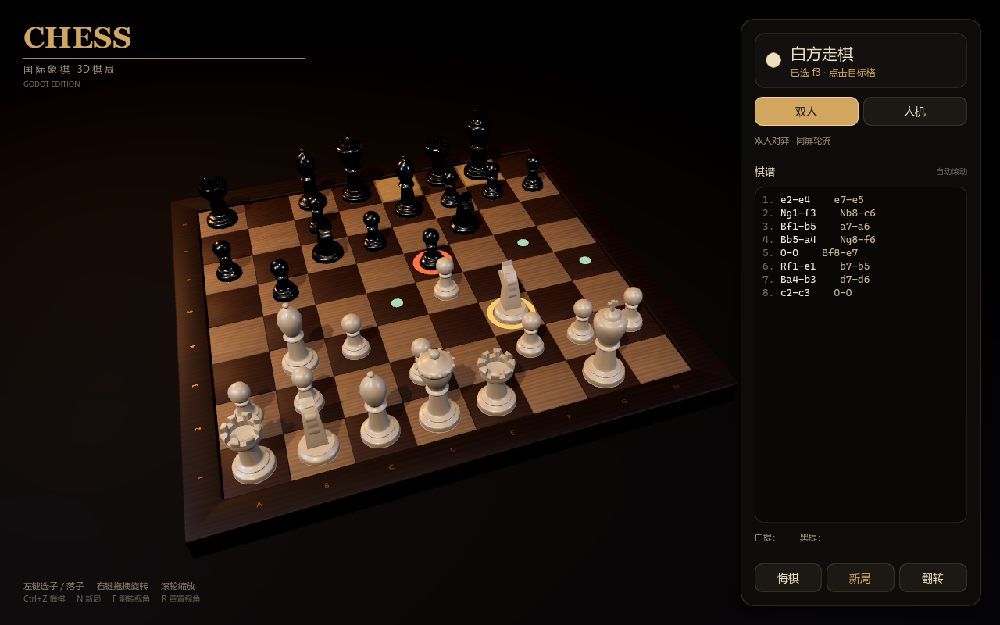

# 国际象棋 ChessSet（Godot）

一个可玩的 3D 国际象棋游戏，使用 Godot 4.7.2 制作。棋盘和棋子来自 `D:\建模blender\#0001` 的 Blender 模型，保留真实的 512 mm 棋盘与 32 个独立棋子。



## 已实现

- 完整走子规则：王、后、车、象、马、兵，含王车易位、吃过路兵、升变
- 将军、将死、逼和、50 回合规则、子力不足和棋
- 人机对战（AI 深度 3，Alpha-Beta + 子力/位置表评估）与本地双人对战
- 可选执白或执黑；执黑时 AI 自动先手
- 点击棋子显示合法落点；吃子、将军、将死都有高亮/音效
- 升变对话框（后 / 车 / 象 / 马）
- 悔棋、新局、视角翻转、鼠标环绕、滚轮缩放
- 棋谱记录、自动滚动、提子统计、回合指示和结算界面
- 程序化木纹桌面、SSAO、软阴影、立体棋子材质和 UI 主题

## 运行

### 直接下载（Windows）

[下载 ChessSet.exe（GitHub Release）](https://github.com/Fairy0019/CASE_BLUE/releases/download/chessset-v1.0.0/ChessSet.exe)

下载后双击运行。exe 约 124 MB，构建产物不进入 Git 仓库（放在 `build/`，由 Release 单独发布）。

本地开发时，构建产物位于：

```text
ChessSet/build/ChessSet.exe
```

首次启动需要编译着色器，可能比后续启动慢一些；之后会使用 `%APPDATA%\Godot\app_userdata` 下的 shader cache。

### 在 Godot 编辑器里运行

1. 用 **Godot 4.7.2** 打开 `D:\ChessSet\project.godot`
2. 按 `F5` 运行
3. 主场景是 `scenes/main.tscn`

## 操作

| 操作 | 功能 |
| --- | --- |
| 左键点击 | 选中棋子 / 落子 |
| 右键拖拽 | 环绕旋转视角 |
| 滚轮 | 拉近 / 拉远 |
| `Ctrl+Z` | 悔棋（人机模式撤销一个完整回合） |
| `N` | 新对局 |
| `F` | 翻转视角 |
| `R` | 重置视角 |
| `Esc` | 取消选择 / 关闭弹窗 |

模式栏里的 **双人 / 人机** 可以切换模式；人机模式下 **换边** 可以重新开局并交换执棋方。

## 工程结构

```text
project.godot
scenes/main.tscn              # 游戏主场景（3D + UI 运行时构建）
scripts/main.gd               # 场景、相机、UI、点击、动画、音效
scripts/chess_game.gd         # 棋规引擎（FEN、perft、走子/悔棋）
scripts/chess_ai.gd           # Alpha-Beta AI
assets/audio/*.wav            # 程序化生成的对局音效
assets/shaders/wood.gdshader  # 棋盘程序化木纹
assets/shaders/table.gdshader # 桌面渐变
assets/ui/splash.png          # 自定义启动画面
ChessSet.blend                # 原始 Blender 模型（Godot 直接导入）
screenshots/                  # 预览截图
export_presets.cfg            # Windows 导出配置
build/ChessSet.exe            # 本地构建产物（Release 附件，不入库）
```

## 模型说明

- `ChessSet.blend` 由 Godot 的 Blender 导入器读取，运行时提取 5 个棋盘部件和 12 组棋子网格，再按棋局状态生成 32 个独立棋子节点。
- 由于 glTF/Blender 的程序化材质不会完整传到 Godot，`main.gd` 中统一覆写了棋子、棋盘、坐标和底垫材质，棋盘使用自定义木纹 shader。
- 棋子、棋盘和点击检测都按真实比例（米制）设置；棋盘顶面 `y = 0.022 m`。

## 规则验证

规则引擎用标准 perft 局面验证过，包括：

- 起始局面 `perft(1..3) = 20 / 400 / 8,902`
- Kiwipete `perft(1..3) = 48 / 2,039 / 97,862`
- Position 3、4、5、6 的标准节点数

覆盖王车易位、吃过路兵、升变、将军逃避、牵制等分支。

## 已知限制

- 本地对战 / 人机对战，无联网
- 未实现三次重复局面判和、认输、提和
- AI 为休闲强度（深度 3），不是 Stockfish 级引擎
- UI 使用系统字体（Microsoft YaHei 等），在缺少这些字体的系统上会回退到其他字体

## 说明

模型由本项目制作；游戏、UI、AI 与规则引擎使用 Godot 4.7.2 和 GDScript 实现。音效由脚本程序化生成，无外部版权素材。

